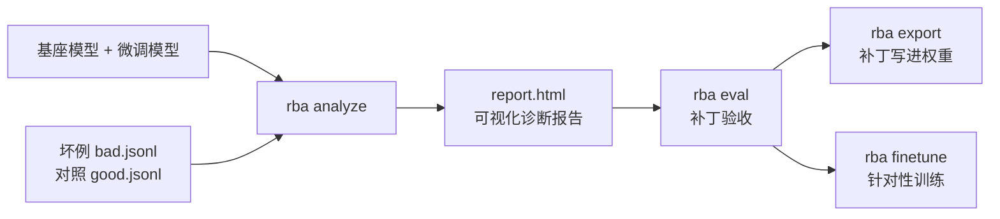
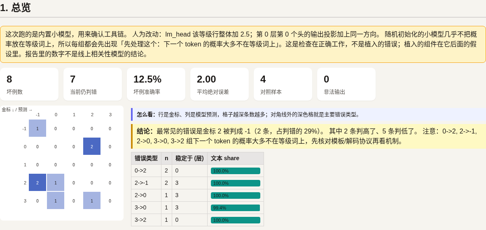
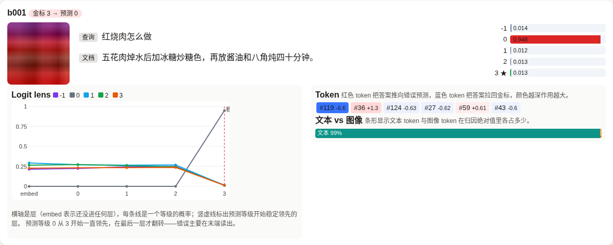
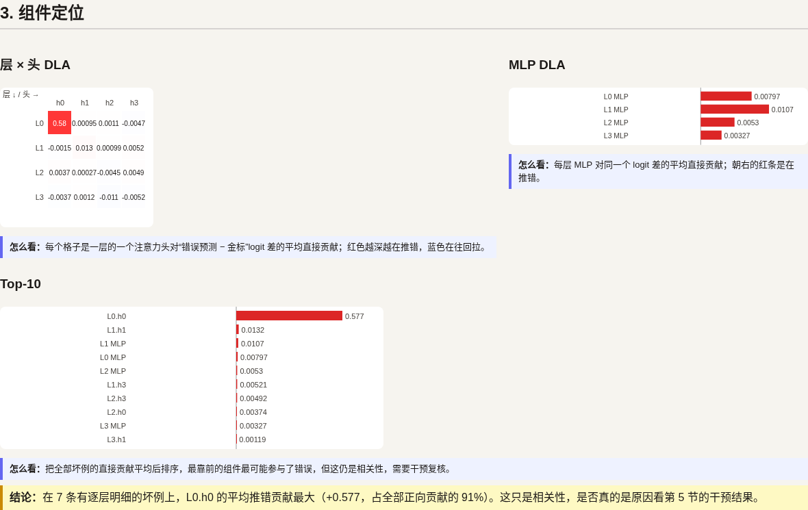
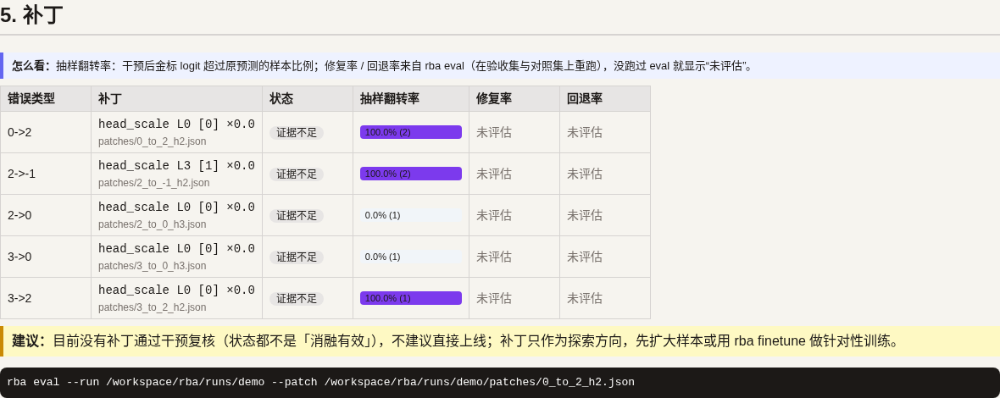
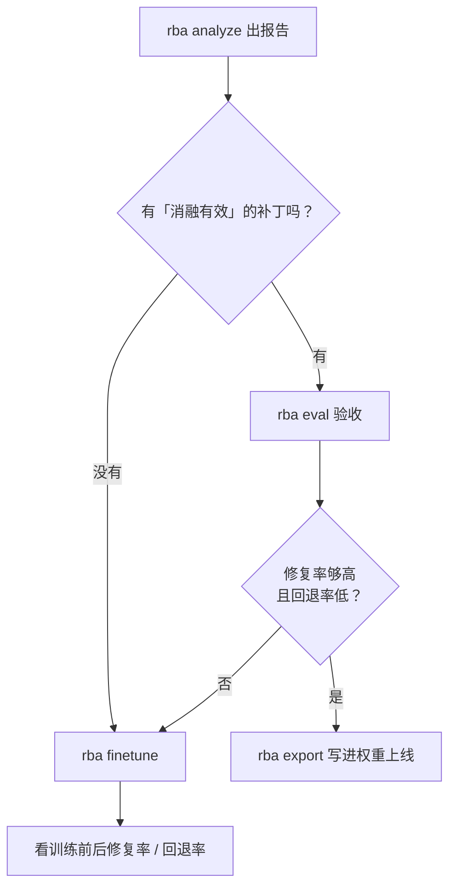
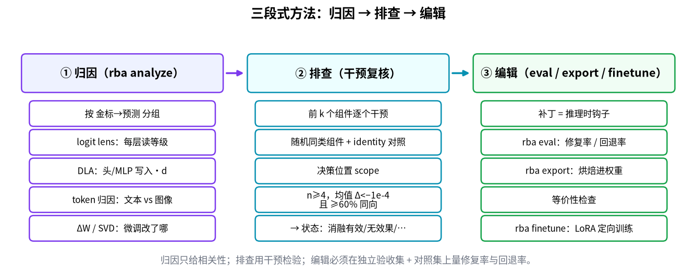

# rba：相关性模型坏例分析

  

你有一个微调过的 Qwen3.5-VL 相关性模型，它读「查询 + 文档（文字或图片）」，只输出一个等级（`-1 0 1 2 3`）。rba 拿它判错的样本，找出最可能是模型里哪一部分（某一层、某个注意力头、某段 MLP）把答案推错了，当场做对比实验验证，并生成一份**可视化报告 `report.html`**（离线单文件，浏览器直接打开）。



## 报告长什么样

| 总览：错误类型热力图 + 结论 | 每条坏例：概率、逐层 logit lens、token 归因 |
| --- | --- |
|  |  |
| **组件定位：层×头 DLA 热力图、Top-K** | **补丁：修复率 / 回退率 + 建议** |
|  |  |

（截图来自 `rba demo` 的随机小模型，数字没有实际意义。）每张图怎么看，见 **[docs/可视化报告.md](docs/可视化报告.md)**。

## 命令速查

| 命令 | 干什么 | 例子 |
| --- | --- | --- |
| `rba demo` | 用内置小模型走一遍全流程，不下载任何东西 | `rba demo` |
| `rba init` | 按模型目录生成一份可改的配置 | `rba init --base 基座 --ft 微调 --badcases bad.jsonl` |
| `rba analyze` | 分析坏例，写 `report.html`（可视化）、`report_detail.html` / `report.md`（全文） | `rba analyze --base 基座 --ft 微调 --badcases bad.jsonl --goodcases good.jsonl --dry-run` |
| `rba report` | 从已有输出目录重新生成 `report.html`，不重算 | `rba report runs/demo` |
| `rba eval` | 在坏例和对照集上验收一个补丁，写 `eval.json` + `report.html` | `rba eval --run runs/xxxx --patch runs/xxxx/patches/3_to_0_h1.json` |
| `rba export` | 把验收过的补丁写进权重，存成标准 checkpoint | `rba export --run runs/xxxx --patch 补丁.json --out exported/` |
| `rba finetune` | 只在定位到的层上做 LoRA / 全量修复训练 | `rba finetune --run runs/xxxx --out runs/xxxx/finetune --steps 200` |

## badcase 怎么修



## 方法一图看懂



先归因（哪层、哪个头、文本还是图像在推错），再排查（一次只动一个组件，看错误分差是否下降），最后编辑（补丁验收、写进权重或定向微调）。每一步具体怎么算、对应哪段代码，见 **[docs/方法图解.md](docs/方法图解.md)**。

## 5 分钟上手

**1. 安装**（在仓库根目录，不下载任何模型）

```bash
pip install -e .
```

**2. 准备坏例文件** `bad.jsonl`，一行一条判错的样本。`label` 是正确等级；`image` 可选，路径相对这个文件。

```json
{"id": "b001", "query": "红烧肉怎么做", "doc": "五花肉焯水后加冰糖炒糖色，再炖四十分钟。", "label": 3}
{"id": "b002", "query": "红烧肉热量高吗", "doc": "五花肉焯水后加冰糖炒糖色。", "image": "img/b002.jpg", "label": 2}
```

再准备一份同格式、模型判对的 `good.jsonl`，用来检查补丁会不会把对的改错。

**3. 一条命令**

```bash
rba analyze --base /path/to/基座模型 --ft /path/to/微调模型 \
  --badcases bad.jsonl --goodcases good.jsonl --dry-run
```

`--dry-run` 表示不调用外部大模型。想让大模型帮你写分析结论，去掉它并设好 `OPENAI_API_KEY`。

手边没有模型？先跑 `rba demo`，它用内置小模型走一遍完整流程。

**4. 打开报告**

命令结束时会打印路径，比如 `runs/xxxx/report.html`。用浏览器打开（离线可用），从「1. 总览」的结论读起；完整文字版证据在同目录的 `report_detail.html` / `report.md`。之后随时可以用 `rba report runs/xxxx` 重新生成。

## 怎么看报告

报告按「金标->预测」分组，比如 `3->0` 表示该是 3 却判成 0。每组下面是几条假设，排在前面的更值得看。一条典型的假设长这样（示意，数字取自 demo，注释是我们加的）：

```text
### 3->0 · 6 条                          ← 这类错误有 6 条样本

1. **[消融有效]** L0.self_attn.h0 的最终读出贡献   ← 状态 + 可疑位置：第 0 层第 0 个注意力头
   干预错误 logit 差均值变化 -86.7             ← 把这个头关掉后，"错答案比对答案高多少"降了 86.7，越负越好
   随机对照 0.48，identity 对照 0              ← 随便关一个别的头几乎没影响，说明不是碰巧
   rba eval --run runs/xxxx --patch runs/xxxx/patches/3_to_0_h1.json
                                              ← 复制运行，看这个补丁能修好多少坏例、弄坏多少好例
```

几个词：

- **logit**：模型给每个等级打的原始分，最高的就是输出。
- **消融**：把某个部件的输出关掉或缩小，看结果怎么变。
- **状态**：「消融有效」= 关掉它确实减少了错误；「证据不足」= 样本太少（每组少于 4 条）或对照没过，别急着下结论；「先处理这个」= 模型几乎不在等级词上放概率，多半是提示词模板和训练时不一样，先修模板。

最后用 `rba eval` 验收补丁。它报两个数：坏例修复率、好例回退率。两个都看，回退率高的补丁不要用。

## 补丁验收之后：导出或微调

- **`rba export`**：把验收过的补丁直接改进权重，存成标准 Hugging Face 目录，上线不需要 rba。导出后会自动拿新模型和「钩子补丁」逐条对比，预测必须一致，并写一份清单 `rba_export_manifest.json`。
  ```bash
  rba export --run runs/xxxx --patch runs/xxxx/patches/3_to_0_h1.json --out exported/
  ```
  能导出：head_scale、mlp_zero、lm_head_blend（共享 embedding 时要加 `--untie-embeddings`）、steering（仅当那一层的 down_proj 自带 bias；Qwen3.5 没有，会拒绝）。不能导出：ablate_tokens / ablate_image。只在决策位置复核过的补丁要加 `--allow-all-positions` 才导出。
- **`rba finetune`**：补丁不够用时，只在分析定位到的层上做 LoRA（或全量）训练，损失只算等级 token；用混淆组做难负例，用对照集回放防回退；最后合并权重，并报告训练前后在留出坏例和留出对照上的修复率 / 回退率。LoRA 需要 `pip install -e '.[finetune]'`。
  ```bash
  rba finetune --run runs/xxxx --out runs/xxxx/finetune --dtype bfloat16 --steps 200
  ```

每个参数、例子和限制见 **[docs/导出与微调.md](docs/导出与微调.md)**。

## 更多

全部命令和参数、数据格式细节、GPU/bf16 说明、报告各部分含义、方法原理、常见问题和已知限制，见 **[docs/使用说明.md](docs/使用说明.md)**。

其他文档：

- **[docs/方法图解.md](docs/方法图解.md)**：归因、排查、编辑三步的流程图、决策树和示意图，逐条对到源码。
- **[docs/可视化报告.md](docs/可视化报告.md)**：report.html 每一节、每张图怎么看。
- **[docs/修复与补丁.md](docs/修复与补丁.md)**：能不能修坏例、每种补丁的字段和用法、怎么读 `rba eval` 的结果、怎么真正上线。
- **[docs/设计评审记录.md](docs/设计评审记录.md)**：发布前两位评审的发现、优先级、每轮改动、故意延期的事项和已知问题。
