# 方法图解：归因 · 排查 · 编辑

这份文档把 `rba` 的三步方法画出来，并逐条对到源码。图里的每个公式、阈值、scope 都按当前代码写；
函数名放在每节末尾的「对应代码」里，方便核对（行号会漂移，所以只写函数名）。

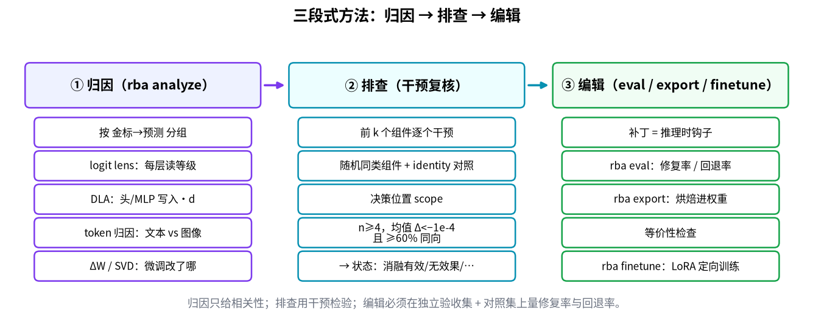

记号（全文统一）：

| 记号 | 含义 | 形状 |
| --- | --- | --- |
| `t*` | 决策位置 = 最后一个非 pad token（`decision_index`；collate 左填充，所以就是末位） | 每条样本一个下标 |
| `h_ℓ` | 第 ℓ 层输出的残差流（取 `t*`） | `[H]` |
| `W_U` | `lm_head.weight` | `[V, H]` |
| `W_U[g]` | 等级 g 的 token 那一行（等级 −1..3 各对应一个 token） | `[H]` |
| `d` | 错误方向 `W_U[pred] − W_U[gold]`（**预测减金标**） | `[H]` |
| `z` | 决策位置 logits 只取 G 个等级列 | `[G]` |
| `Δ` | 干预后分差 − 干预前分差，分差 = `z[pred] − z[gold]` | 标量，**负 = 变好** |

> 符号约定：所有归因都对「错误分差」`logit[pred] − logit[gold]` 做。**正值 = 把模型推向错误预测**，负值 = 拉回金标。

---

## 1. 归因：一次前向里记下了什么

### 1.1 钩子挂在哪

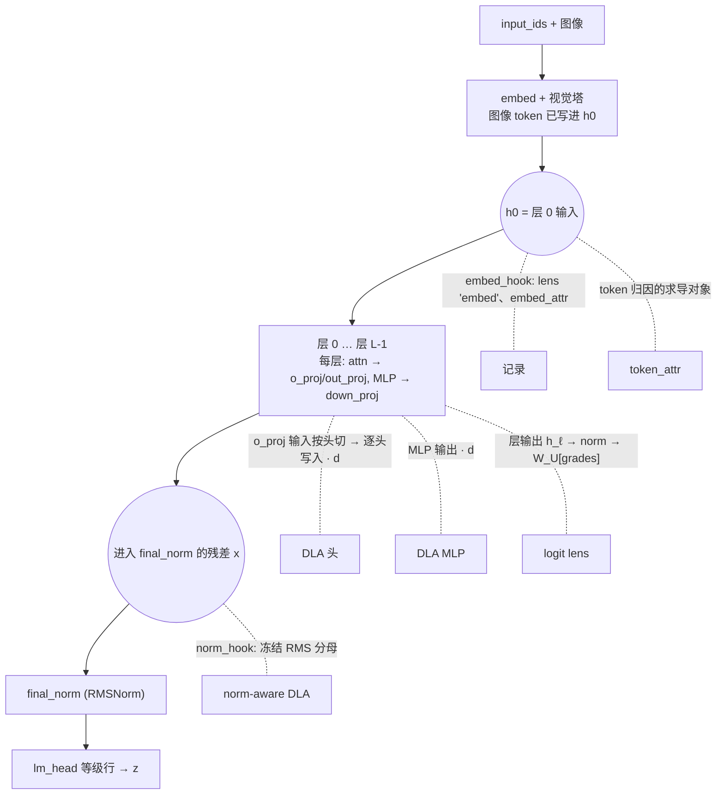

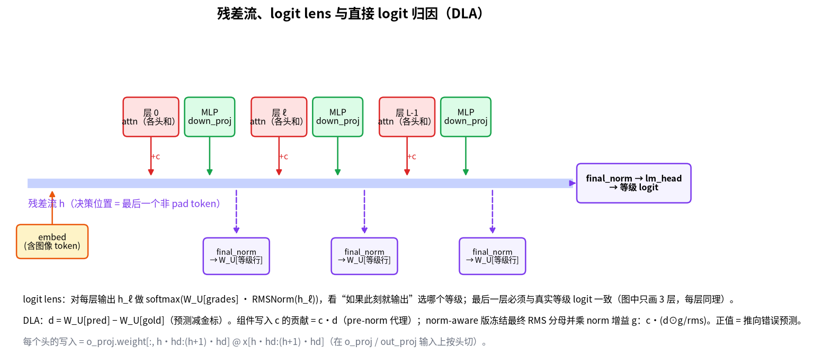

### 1.2 Logit lens：每层「如果此刻就输出」选哪个等级

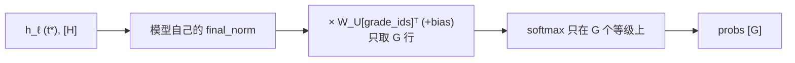

- 每条明细样本得到 `embed` + 每一层的等级分布；报告里的折线就是它。
- **最后一层的 lens 必须等于真实输出**——这是接线检查，不是发现。
- `flip_layer`（report.json 里的组级字段）：组内平均 lens 分差 `logit[pred] − logit[gold]` 第一次 > 0 的层，之后不要求保持。
- 注意 report.html 卡片上的竖虚线（「稳定于」）是另一个定义：从该层起预测等级**一直**是 argmax 的第一层（`report/visual.py::_flip_layer`）。两者可能不同。
- lens 的 softmax 只在 G 个等级上；`grade_mass`（全词表 softmax 里等级 token 的总质量）是另一回事：等级内很自信不代表模型愿意输出等级词。

对应代码：`analysis/instrument.py::instrument_batch` 内的 `project`、`layer_hook`、`embed_hook`；`analysis/hypotheses.py::aggregate_mechanistic`。

### 1.3 DLA：每个头 / 每个 MLP 往错误方向写了多少

残差流是加法：`x = h0 + Σ_ℓ (attn_ℓ + mlp_ℓ)`。所以每个组件的写入 `c` 都能单独和 `d` 点乘。

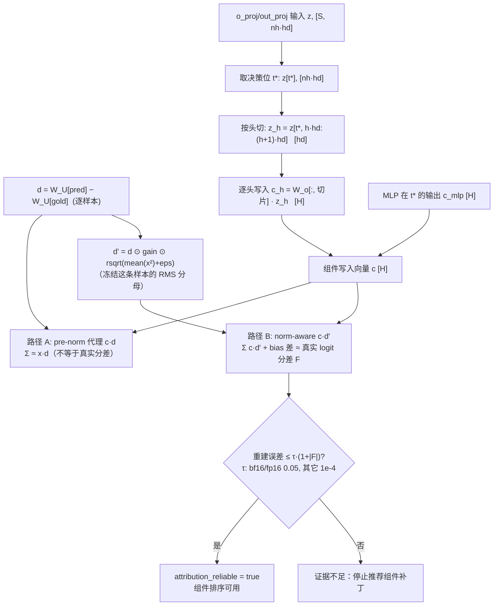

要点：

- 两条路径**不能混**：RMSNorm 不是线性的，路径 A 的和只等于 `x·d`，不等于真实 logit 分差。路径 B 冻结了这条样本实际的 RMS 分母，并探测出 norm 的增益 `gain`（同时兼容 `w` 和 `1+w` 两种写法），所以组件和 + bias 差能重建真实分差。
- 有 norm-aware 结果时，聚合会用路径 B（`norm_*_attr`）**覆盖** pre-norm 值，热力图和组件排序都用它；模型的 norm 不支持时退回路径 A，并标 `readout_kind=pre_norm_proxy`、视为不可靠。它是「冻结分母的读出贡献」，**不是因果效应**，也不是雅可比。
- 头是在 `o_proj`（全注意力）或 `out_proj`（GatedDeltaNet 线性注意力）的**输入**上按 `head_dim` 切的；线性注意力层切的是 value 头。
- `decomposition_gap = |路径A和 − x·d| / (|x·d|+1e-6)`，> 0.15 时只**告警**；可靠与否以 `attribution_reliable`（路径 B 重建误差）为准，gap 仅是旧记录的回退判据。
- `share = |mean| / Σ|mean|` 的分母只含采集到的头和 MLP，不含 embed 与 bias。

对应代码：`instrument.py::norm_readout_direction`、`proj_hook`、`mlp_hook`、`attn_module_hook`；`hypotheses.py::aggregate_mechanistic`（`share = |mean| / Σ|mean|`）。

### 1.4 token 归因：文本 token 还是图像 token 在推错

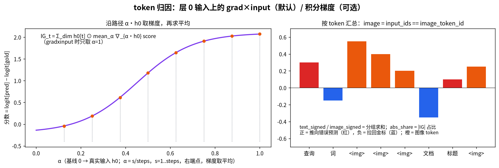

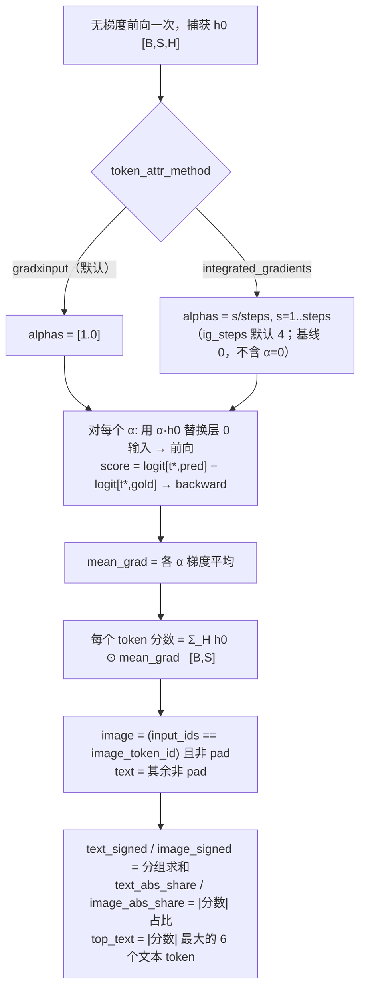

- 这是**语言模型入口处的 token 归因**，不是像素归因：视觉塔已经把图像写进 `h0`，梯度只到这里。α 同时缩放所有位置，不是逐个 token 消融。
- 「文本」= 非 pad 且不是图像 token，所以也包含模板里的特殊 token。报告只保存聚合值和 top 6 文本 token，不存完整逐位置色带。
- 没有做 IG 完整性（completeness）检查，图上也不画。
- 「图像占多少」有三个不同的数，互不可换：`image_token_fraction`（token 个数占比）、`attn_image_share`（注意力质量，只算返回权重的全注意力层）、`image_abs_share`（本节的梯度归因）。

对应代码：`analysis/token_attr.py::attribute_batch`；配置 `token_attr_method`、`ig_steps`（`config.py`）。

### 1.5 ΔW / SVD：微调到底改了哪

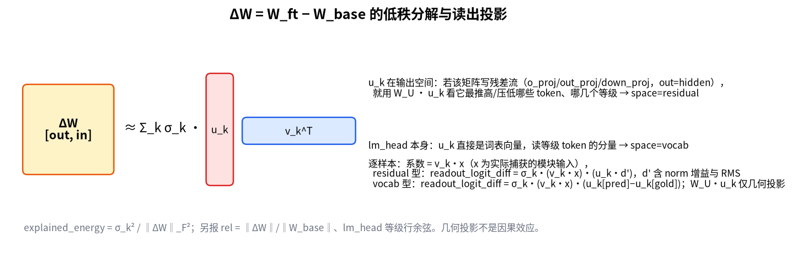

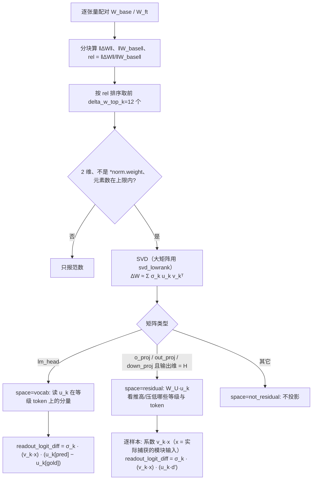

- `explained_energy = σ_k² / ‖ΔW‖_F²`；符号约定：u 绝对值最大的坐标取正，v 同步翻转，ΔW 不变。
- lm_head 等级行单独报告「新旧行余弦」和 `‖Δ行‖`；`余弦 < 0.98 或 ‖Δ行‖ > 0.5` 时才考虑 lm_head 假设。
- 真 2B 模型的 lm_head（约 248k×2048）超过 SVD 元素上限，通常看不到 vocab 方向，只看行报告。
- SVD 对 top 的二维权重都做（rank=`svd_rank` 默认 4，元素上限 `svd_max_dim`）；只有「语义投影」受 residual/vocab 类型限制。`W_U·u_k` 只是几何投影，不是 readout_logit_diff。
- vocab 方向与「等级行变化」依赖**基座词表对齐**：`check_base_grade_alignment` 发现等级编码冲突直接报错；无法确认完整映射时 `_sanitize_unaligned_directions` 删掉 vocab 方向的等级/top-token 语义。
- **几何投影不是因果**：它说明「改动可能写到哪个方向」。当前没有针对单个奇异方向的删除/恢复实验；第 2 节的头/MLP 消融或行混合也不等于验证了某个奇异方向。

对应代码：`analysis/delta_w.py::analyze_delta`、`_svd_project`、`_grade_row_report`；`instrument.py` 里的 `capture_delta`。

---

## 2. 排查：症状 → 信号 → 假设 → 验证

### 2.1 总流程

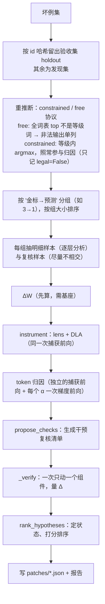

### 2.2 症状 → 看哪个信号

| 症状 | 信号 | 字段 | 触发条件 |
| --- | --- | --- | --- |
| 输出常常不是等级词 | 决策位置的等级概率质量 | `grade_mass` | `< 0.5` → 「先处理这个」，先查模板/解码协议 |
| 某层之后翻转成错的等级 | logit lens | `flip_layer` | 组均值分差首次 > 0 的层 |
| 个别头 / MLP 在推错 | DLA 路径 B | `components[].mean_attr / share` | 取组内前几个（复核前 `verify_top_k=3`） |
| 图像可能主导 | 注意力份额 / token 归因 | `attn_image_share` / `image_signed`、`image_abs_share` | ≥ 0.35 → 加图像消融复核；`image_signed>0` 且 `abs_share ≥ 0.2` → 图像假设 |
| 等级读出被微调改了 | ΔW 等级行 | `cosine_to_base`、`delta_norm` | `< 0.98` 或 `> 0.5` 就生成假设（需基座等级对齐）；lm_head 与 embedding 未共享时才附可执行的行混合复核，共享时 patch 为空 |
| 分解本身不可信 | 重建误差 | `attribution_reliable` | 不可靠 → 「证据不足」，组件补丁全部撤掉 |

### 2.3 一次复核怎么做（激活干预 / 消融）

> 范围说明：当前实现的是**同一输入上的消融/缩放干预**（目标组件 vs 不动）。经典 activation patching（把 clean 运行的激活搬进 corrupt 运行、或从基座模型移植激活）**没有实现**；文中所说「因果检查」都指这种单输入干预。

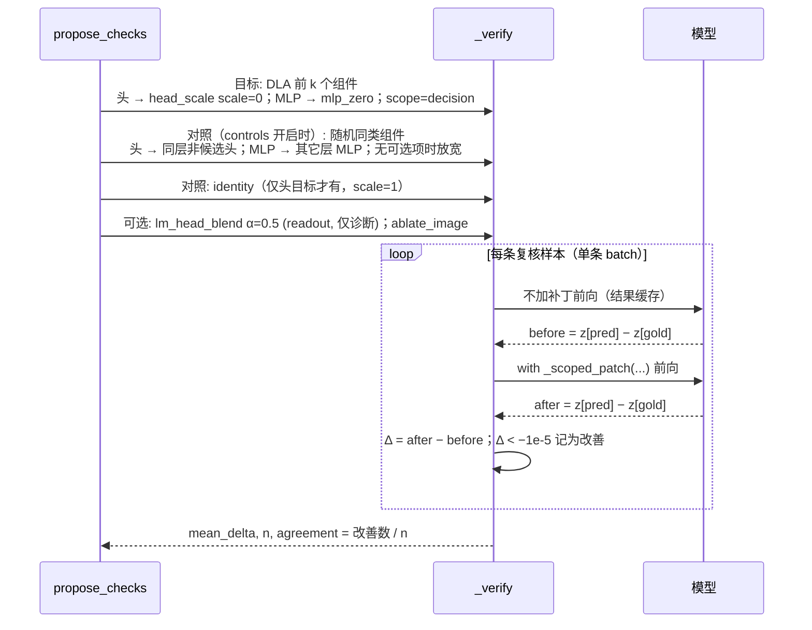

- 复核默认 **scope = decision**：只在 `t*` 这个位置改（head_scale 只改 `t*` 处那几个头的切片、mlp_zero 只在 `t*` 清零、steering 只在 `t*` 加）。
- 复核用 **scale = 0**（完全去掉这个头）；写给用户的「温和提案」是 scale = 0.5，这个提案没被原样复核，报告会注明「须单独验收」。
- `ablate_image` 在复核时被改写成 `ablate_tokens(token_ids=[image_token_id])`。
- 计算 Δ 时 pred / gold 固定为干预前的那一对，不在干预后重新取 argmax；Δ<0 只说明错误分差缩小，不等于这条样本已被修好。
- 复核样本优先取组内没进明细的剩余样本（`selection_disjoint=true`）；**完全没有**剩余样本时才回用明细样本（剩 1–3 条也照用剩余，可能因 n<4 判证据不足），并在证据里注明「选择与验证样本未证明独立」。

### 2.4 状态判定决策树

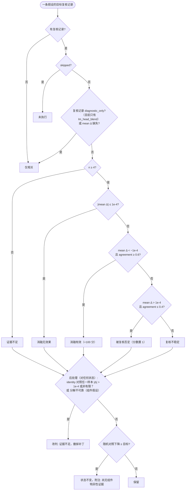

- 三个阈值不同，别混：逐例「改善」用 `Δ < −1e-5`；状态用 `±1e-4`；identity 对照用 `|Δ| > 1e-4`。
- 「消融有效」只说明这个干预降低了错误分差，**不证明根因**。
- 排序分数：组件 `10 + 20·share`（消融有效再 +100）；lm_head 假设 25；图像假设 30；「先处理这个」300；分解不可靠 290。
- 推荐：状态为「消融有效 / 已验证」且带非诊断补丁的前 2 条标 `recommend`；一条都没有时，第一条带补丁且没被否定的标 `exploratory`。凡是**假设级** `diagnostic_only` 的都不自动推荐：`lm_head_blend`、`mlp_zero`、图像假设即使「消融有效」也只能手动 `rba eval`。
- 注意两层 `diagnostic_only`：`_status` 读的是复核记录上的（只有 lm_head 检查带），`_mark_recommended` 读的是假设上的（MLP、图像、lm_head 都带）。

对应代码：`analysis/hypotheses.py::propose_checks`、`_status`、`rank_hypotheses`、`STATUS_RULES`；`pipeline.py::_verify`、`_scoped_patch`、`_decision_position_patch`、`_mark_recommended`。

---

## 3. 编辑：补丁、复评、烘焙、微调

### 3.1 每种补丁在前向里改了什么

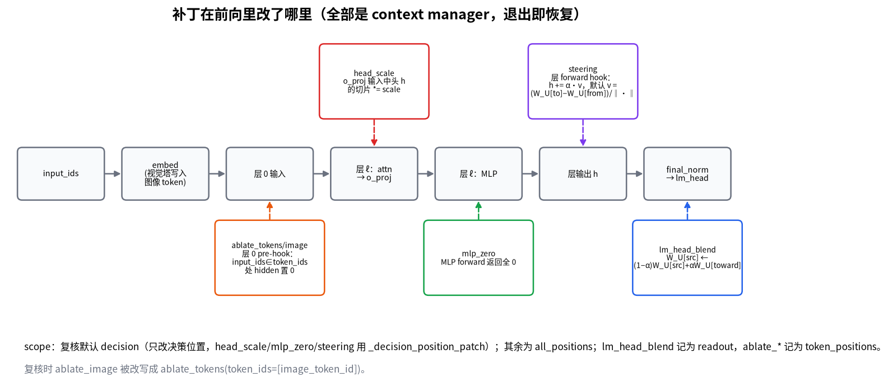

| method | 改哪里 | 公式 | 复核/评估时的 scope | 能否烘焙 |
| --- | --- | --- | --- | --- |
| `head_scale` | `o_proj`/`out_proj` 的**输入** | `z[..., h·hd:(h+1)·hd] *= scale`（线性，等价于缩放该头的写入；同层多条会叠乘） | decision 或 all_positions | 能：`W_o[:, h·hd:(h+1)·hd] *= scale`（**列**） |
| `mlp_zero` | 整个 MLP 输出 | `mlp(h) = 0` | decision 或 all_positions | 能：`down_proj.weight`（和 bias）清零 |
| `steering` | 指定层的输出（默认最后一层） | `h += α·v`，默认 `v = (W_U[to] − W_U[from]) / ‖·‖`（单位向量，α 是 hidden 坐标里的长度）；自定义 `vector` **不归一化** | decision 或 all_positions | 仅当 `down_proj` 自带 bias 且层后没有 post-MLP norm：`bias += α·v`。Qwen3.5 无 bias → 拒绝 |
| `lm_head_blend` | `lm_head` 一行 | `W_U[src] ← (1−α)·W_U[src] + α·W_U[toward]`（默认 α=0.5）；toward 行和 bias 不动 | readout | 能：改**一行**；lm_head 与 embedding 共享权重时需 `--untie-embeddings` |
| `ablate_tokens` / `ablate_image` | 层 0 输入 | `input_ids ∈ token_ids` 的位置 `h0 = 0`（mask 不变） | token_positions（只在 eval/复核的打分前向里生效：依赖 `forward_scores` 设置的 `model._rba_input_ids`） | 不能：效果取决于输入内容 |

全部补丁都是 context manager：退出即恢复原 forward / 原权重，`rba eval` 不会留下修改。

- `ablate_*` 把那些位置的表示清零，但位置仍在、mask 不变，后续层照样会处理这些（零向量）位置。
- 同一层重复列出的头号只缩放一次（钩子、决策位置钩子、烘焙三处现已一致）。
- 多个补丁按顺序叠加；例如先 blend 再算 steering 方向会得到不同的 v，所以顺序有意义。

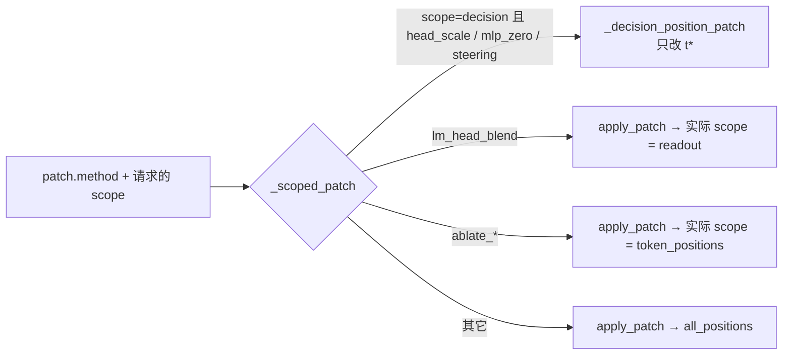

对应代码：`repair/interventions.py::scale_heads / steer / blend_lm_head / zero_mlp / ablate_token_ids / steering_vector / apply_patch`；`pipeline.py::_scoped_patch`。

### 3.2 `rba eval`：修复率与回退率

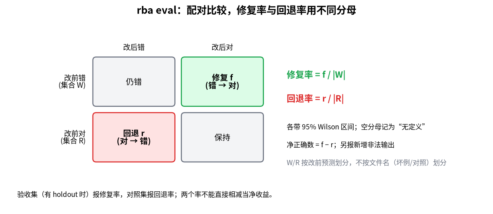

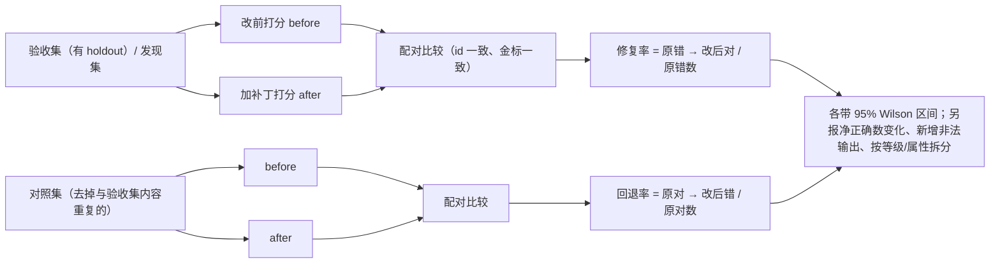

| | 改后对 | 改后错 |
| --- | --- | --- |
| **改前错** | 修复（计入修复率分子） | 仍错 |
| **改前对** | 保持 | 回退（计入回退率分子） |

`W`（改前错）/`R`（改前对）按**改前预测**划分，不按文件名划分；空分母记为「无定义」而不是 0。两个率分母不同，不能直接相减算净收益；净收益取决于线上错误占比，应使用独立验收集和预设回退上限。

对应代码：`repair/evaluate.py::_paired_counts / compare / wilson_interval / conclusion`；`pipeline.py::evaluate_patch`。

### 3.3 `rba export`：把补丁烘焙进权重

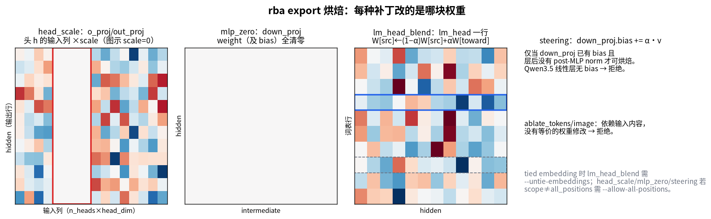

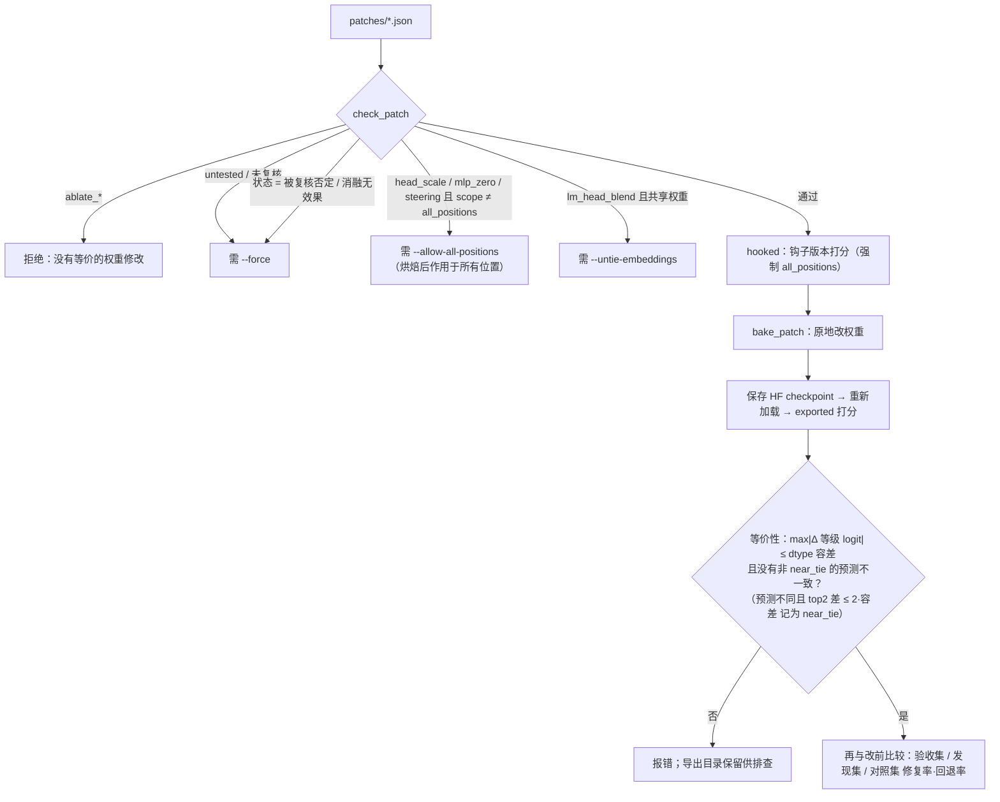

`lm_head_blend` 正常 scope 就是 readout，不需要 `--allow-all-positions`；`ablate_*` 加了这个开关也不能烘焙。

等价性检查只在抽样样本的等级 logits 上做数值核对，不是对全输入、全词表的严格证明；`--check-only` 提前返回，不经过 `bake_patch` 的架构检查。

注意：等价性检查比较的是「全位置钩子 vs 导出模型」，**不是**「决策位置复核结果 vs 导出模型」。用 scope=decision 复核的补丁，烘焙后行为会变，回退率以导出后的数字为准。

对应代码：`repair/bake.py::check_patch / bake_patch / untie_lm_head / equivalence / export_patches`；容差 `repair/common.py::TOLERANCE`。

### 3.4 `rba finetune`：补丁不够时的定向训练

> `rba export` 和 `rba finetune` 是两个独立入口：eval 之后「能烘焙 → export → 等价性核对」，「需要训练 → finetune → 留出评估」，微调不需要先导出。

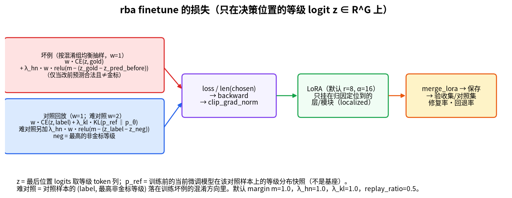

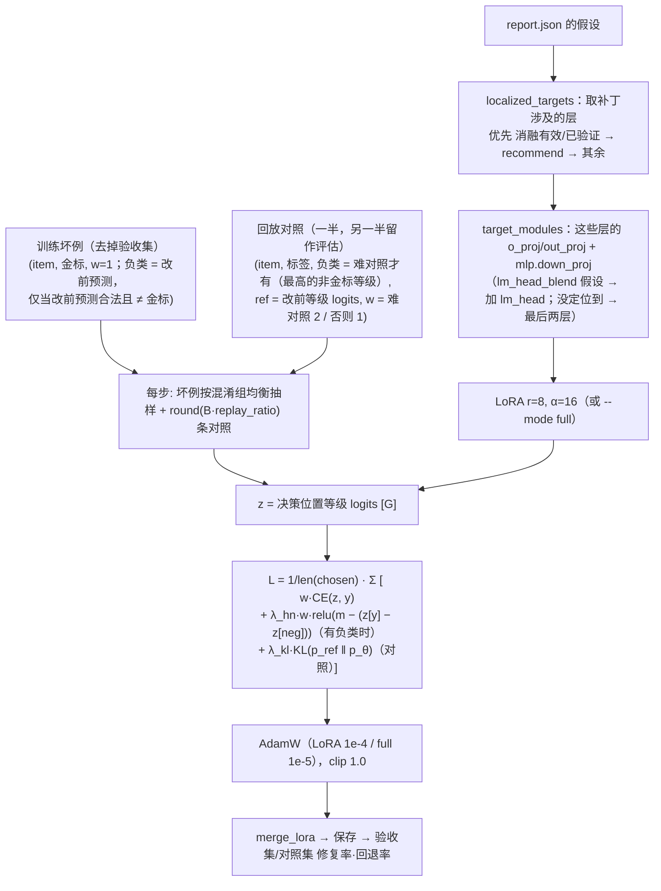

- CE 只在 **G 个等级 logit** 上做（等级内 softmax），不是全词表语言模型 loss。
- hinge 也作用于**难对照**：对照样本的 (标签, 最高的非金标等级) 落在训练坏例的混淆方向上时，它也有负类，且权重加倍。
- `p_ref` 是**训练前的当前微调模型**在该对照样本上的等级分布快照，不是基座模型，也不随训练更新。
- 日志里的 CE / 难负例 / KL 三项是未乘系数的原始值，不能直接相加成 total loss。
- `--mode full --targets all` 才训练全部参数；LoRA 下 `targets=all` 仍只挂在各层的输出投影和 down_proj 上。
- KL 是 `KL(p_ref ‖ p_θ)`（`kl_div(log p_θ, log p_ref, log_target=True)`），方向不要画反；它不乘 w。
- 坏例文件里改前就判对的样本、非法预测样本没有负类，只有 CE。
- 「最高的非金标等级」：最高的是金标时取第二名，否则取第一名（对照不保证都判对）。
- 默认 `margin=1.0, hard_negative_weight=1.0, kl_weight=1.0, replay_ratio=0.5, steps=100, train_batch_size=4`。

对应代码：`repair/finetune.py::FinetuneOptions / localized_targets / target_modules / add_lora / merge_lora / _grade_logits_train / finetune`。

---

## 4. 一张时间线：scope 在各步怎么变（以 head_scale 为例）

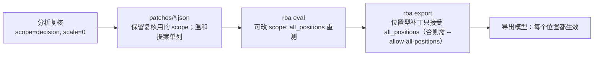

## 5. 怎么重画这些图

- 静态图：`.venv/bin/python scripts/make_method_figures.py`（matplotlib，自动选 Noto Sans CJK 等中文字体），输出 `docs/images/method_*.png`。图里的数字是示意，不来自真实模型。
- mermaid：`scripts/check_mermaid.sh` 用 `mmdc`（mermaid-cli，需自行 `npm i -g @mermaid-js/mermaid-cli`）逐块渲染检查。
- 每次跑 `rba analyze` 生成的 `report.html` 末尾有「7. 方法原理」一节：三张紧凑流程图 + 一张「每个信号怎么算 / 本次运行的数 / 去哪看」表，链接到对应的坏例卡片和章节，完全离线。
